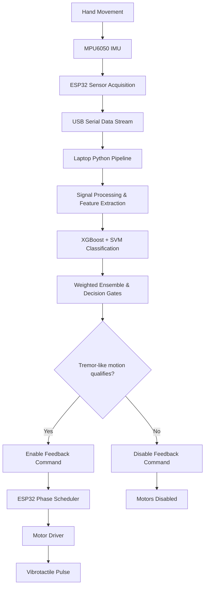

# Wearable Tremor Detection & Phase-Timed Haptic Feedback Glove

A wearable engineering prototype that combines **inertial sensing, machine learning-based tremor-like motion classification, and phase-timed vibrotactile feedback** to explore a technology-assisted approach to hand tremor monitoring.

<p align="center">
  
</p>

<p align="center">
  <i>Hardware prototype during development</i>
</p>

---

## Overview

Hand tremors can interfere with everyday activities requiring fine motor control, such as writing, holding objects, and performing precise movements. This project explores a wearable sensing and feedback system that captures hand motion, analyzes movement patterns using machine learning, and generates timed vibration feedback based on detected tremor-like activity.

The system uses an **ESP32 microcontroller and MPU6050 IMU** for motion acquisition, while a laptop performs machine learning inference and signal analysis. When predefined detection conditions are satisfied, the system sends an enable command to the microcontroller, which schedules vibration pulses based on the estimated tremor phase.

The project brings together embedded systems, signal processing, machine learning, serial communication, and motor control in a single prototype.

> **Disclaimer:** This is an experimental engineering prototype. It is not a medical diagnostic device, does not diagnose Parkinson's disease, and has not been clinically validated to reduce tremors.

---

## System Architecture



### Two-layer processing architecture

**1. Embedded layer — ESP32**

- Samples inertial sensor data.
- Streams six-axis motion measurements to the laptop.
- Performs local tremor-cycle timing estimation.
- Handles phase-timed vibration scheduling.
- Controls the motor driver and safety shutdown conditions.

**2. Machine learning layer — Laptop**

- Receives sensor data through USB serial.
- Segments motion into overlapping windows.
- Extracts engineered features.
- Performs standardized machine learning inference.
- Combines model predictions and applies decision gates.
- Sends feedback enable/disable commands to the ESP32.

---

## Hardware Components

| Component | Purpose |
|---|---|
| ESP32 | Embedded control, sensor acquisition and motor timing |
| MPU6050 IMU | 3-axis accelerometer and 3-axis gyroscope |
| DRV8833 H-bridge | Vibration motor control |
| ERM vibration motor(s) | Vibrotactile feedback |
| ULN2003 | Auxiliary output driver in the prototype |
| Power supply | Powers the embedded hardware |
| Wearable glove | Physical platform for sensor and actuator integration |

---

## Machine Learning Pipeline

The laptop-side prediction system processes motion data using a feature-based classification pipeline.

### Data acquisition

The MPU6050 provides six motion channels:

- Accelerometer: X, Y, Z
- Gyroscope: X, Y, Z

The ESP32 samples the sensor at approximately **100 Hz** and streams the measurements through USB serial.

### Windowing

- Window size: **100 samples**
- Window duration: **1 second**
- Hop size: **50 samples**
- Overlap: **50%**

### Feature extraction

Each window is transformed into **16 engineered features** incorporating time-domain, frequency-domain, and signal-complexity characteristics.

The features are standardized before being passed to the trained classifiers.

### Classification models

The system uses two classifiers:

- **XGBoost**
- **Support Vector Machine (SVM)** with an RBF kernel

Their outputs are combined through weighted soft voting:

| Model | Ensemble weight |
|---|---:|
| XGBoost | 0.55 |
| SVM | 0.45 |

---

## Detection & Feedback Logic

A positive machine learning prediction alone is not sufficient to activate the vibration motors.

The system applies multiple decision gates:

| Condition | Requirement |
|---|---|
| Ensemble score | At least 50% |
| Gyroscope RMS | At least 180 |
| Estimated peak frequency | Between 3.5 and 7.5 Hz |
| Temporal consistency | Two consecutive qualifying windows |

Only when the required conditions are satisfied does the laptop issue an enable (`G`) command. Otherwise, it sends a disable (`D`) command.

### Phase-timed vibration

The ESP32 estimates tremor cycle timing using local signal processing, including band-pass filtering and signed gyroscope zero-crossing detection.

When feedback is enabled, the controller schedules short vibration bursts at a nominal phase offset of **180°** relative to the estimated tremor cycle.

| Parameter | Configuration |
|---|---|
| PWM carrier frequency | 1 kHz |
| Motor burst duration | 30 ms |
| Nominal phase offset | 180° |
| Host communication | USB Serial |
| Baud rate | 115200 |

---

## Safety & Fail-Safe Behavior

The prototype includes safeguards intended to prevent uncontrolled motor activation:

- Motors remain disabled during startup.
- Feedback requires an explicit enable command.
- Invalid phase estimates disable motor output.
- Missing or invalid sensor data disables output.
- A host communication timeout disables motors.
- A sensor data timeout disables motors.
- A disable command immediately stops motor output.

| Safety condition | Timeout |
|---|---:|
| Host command timeout | 1200 ms |
| Sensor data timeout | 250 ms |

---

## Software & Technologies

**Embedded systems**
- ESP32
- Arduino/C++
- MPU6050
- I²C
- PWM
- Serial communication

**Machine learning & signal processing**
- Python
- NumPy
- Pandas
- Scikit-learn
- XGBoost
- SciPy

**Hardware control**
- DRV8833
- Vibrotactile motor actuation
- Phase estimation and pulse scheduling

---

## Project Structure

```text
wearable-parkinsons-tremor-control/
│
├── firmware/
│   └── ESP32 firmware
│
├── models/
│   ├── trained classifier
│   └── preprocessing scaler
│
├── data/
│   └── motion datasets
│
├── python/
│   ├── prediction pipeline
│   ├── feature extraction
│   └── diagnostic scripts
│
├── images/
│   └── prototype.jpg
│
├── requirements.txt
└── README.md
```

*The folder structure above is illustrative; adjust it to match the actual repository contents.*

---

## Current Results & Limitations

The project demonstrates an integrated sensing and processing pipeline, including inertial data acquisition, serial streaming, feature extraction, model inference, ensemble scoring, decision gating, and embedded feedback scheduling.

Testing also exposed limitations in model generalization to live sensor conditions. The trained classifiers frequently rejected rhythmic movement during live demonstrations, indicating a mismatch between the training data and live sensor measurements.

### Current limitations

- Limited training data diversity.
- Training-to-live sensor distribution mismatch.
- No clinical validation.
- No demonstrated reduction in tremor amplitude.
- Reliable ML-triggered motor activation under all live conditions has not yet been established.

These limitations are important areas for further experimentation rather than claims of achieved clinical effectiveness.

---

## Future Improvements

- Collect a larger and more diverse motion dataset.
- Improve training data quality and sensor calibration.
- Evaluate model generalization on unseen recordings.
- Investigate adaptive frequency estimation.
- Improve hardware packaging and wearable ergonomics.
- Measure actuation timing and repeatability.
- Conduct controlled experiments to quantify the effect of haptic feedback.
- Explore edge-based inference to reduce laptop dependency.

---

## Contributors

Developed as an academic engineering project involving wearable hardware, embedded programming, machine learning, signal processing, and haptic feedback.

---

## Acknowledgements & Code Attribution

This repository contains code adapted from an existing project. Credit the original author and repository here:

- **Original repository:** [Add original GitHub repository link]
- **Adaptations:** [Describe your own modifications, experiments, integrations, and contributions]

Please refer to the original repository for the original implementation and attribution.

---

## Disclaimer

This project is intended for educational and experimental engineering purposes only. It is not intended to diagnose, treat, cure, or prevent Parkinson's disease or any other medical condition. The vibration feedback has not been clinically evaluated for tremor suppression.
# Parkinsons-Tremor-Detection
